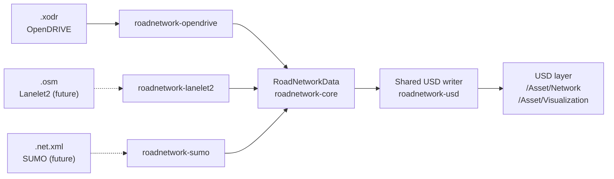

# OpenUSD Road Network Plugins

> **Status:** under development; this README describes the intended project.
> The [current work](docs/roadmap/current.md) page names the active phase, and
> the [capability matrix](docs/reference/CAPABILITY_MATRIX.md) is the only
> source for what the tree supports.

**Open road-network formats — starting with ASAM OpenDRIVE (`.xodr`) —
directly as OpenUSD layers**, and reuse them for composition, inspection,
visualization, and simulation without an external conversion step.

An [OpenStrata](https://github.com/animu-sphere/open-strata) project, built on
the same structure as
[`usd-3dgs-plugins`](https://github.com/animu-sphere/usd-3dgs-plugins).

## Goals

- **Opens where USD already works.** Each format registers as an
  `SdfFileFormat`, so `SdfLayer::FindOrOpen`, `UsdStage::Open`, `usdcat`, and
  `usdview` read it as a layer.
- **Keeps the meaning.** Roads, lanes, junctions, and their connectivity stay
  machine-readable; information that cannot be represented is diagnosed, not
  dropped.
- **Separates data from visualization.** A semantic layer is always authored;
  centerlines, boundaries, and surfaces are derived geometry introduced in
  stages.
- **One model, one writer.** Every format decodes into a shared,
  USD-independent `RoadNetworkData` and is authored by one shared writer, so a
  second format reuses the USD side unchanged.
- **Composes like any other asset.** References and payloads combine a road
  network with the rest of a scene.

## How it will work

## Formats

ASAM OpenDRIVE `.xodr` comes first. Lanelet2, SUMO, and OpenStreetMap are
candidates; their priority is in the
[design policy](docs/design/DESIGN_POLICY.md#4-format-strategy) and their
status in the capability matrix.

Import is read-only. Traffic simulation, vehicle control, rendering, and
physics are out of scope; see the
[design policy](docs/design/DESIGN_POLICY.md#3-scope-and-responsibilities).

## Documentation

- [Documentation index](docs/README.md) — which document owns which question
- [Design policy](docs/design/DESIGN_POLICY.md) — principles and scope
- [Workspace contract](docs/architecture/WORKSPACE.md) — components and dependencies
- [ADRs](docs/adr/) — decisions and their status
- [Release plan](docs/roadmap/release-plan.md) — phases and the feature list
- [Current work](docs/roadmap/current.md) — what is being built now

## Contributing

See [CONTRIBUTING.md](CONTRIBUTING.md). Participation follows the
[Code of Conduct](.github/CODE_OF_CONDUCT.md); report vulnerabilities
privately as described in the [security policy](.github/SECURITY.md).

## License

Licensed under the [Apache License 2.0](LICENSE). Third-party components are
listed in [THIRD_PARTY_NOTICES.md](THIRD_PARTY_NOTICES.md).
