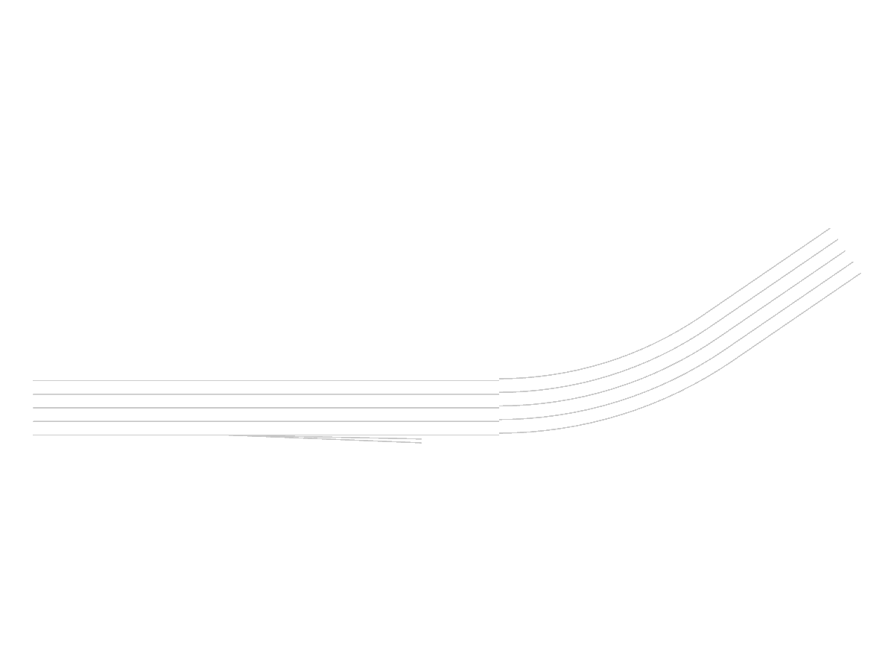
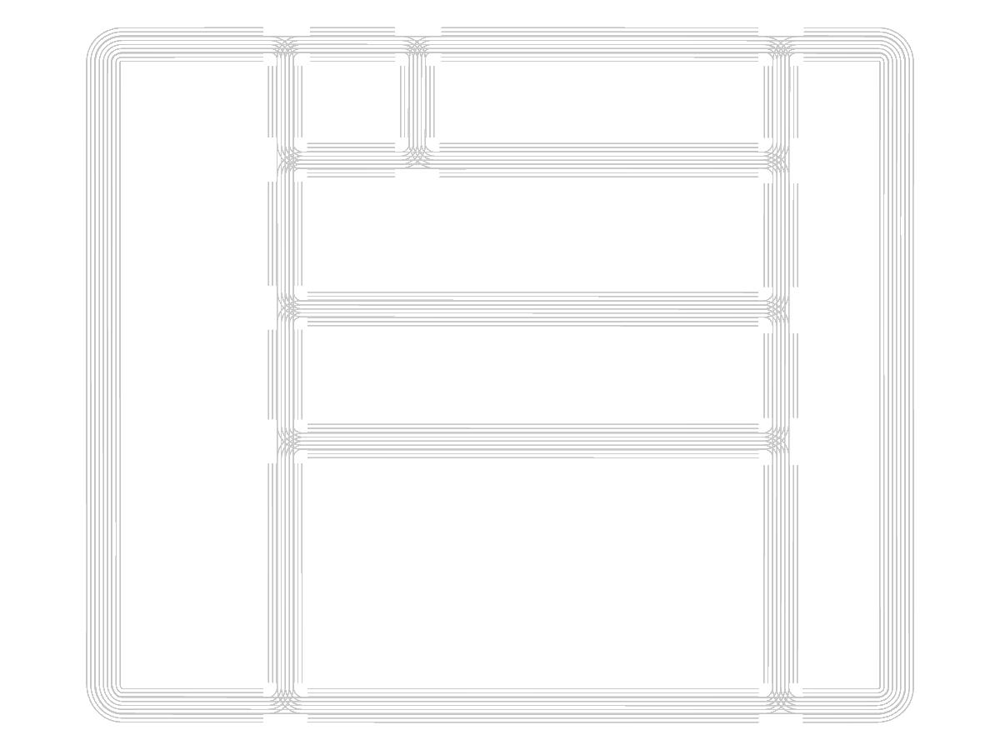
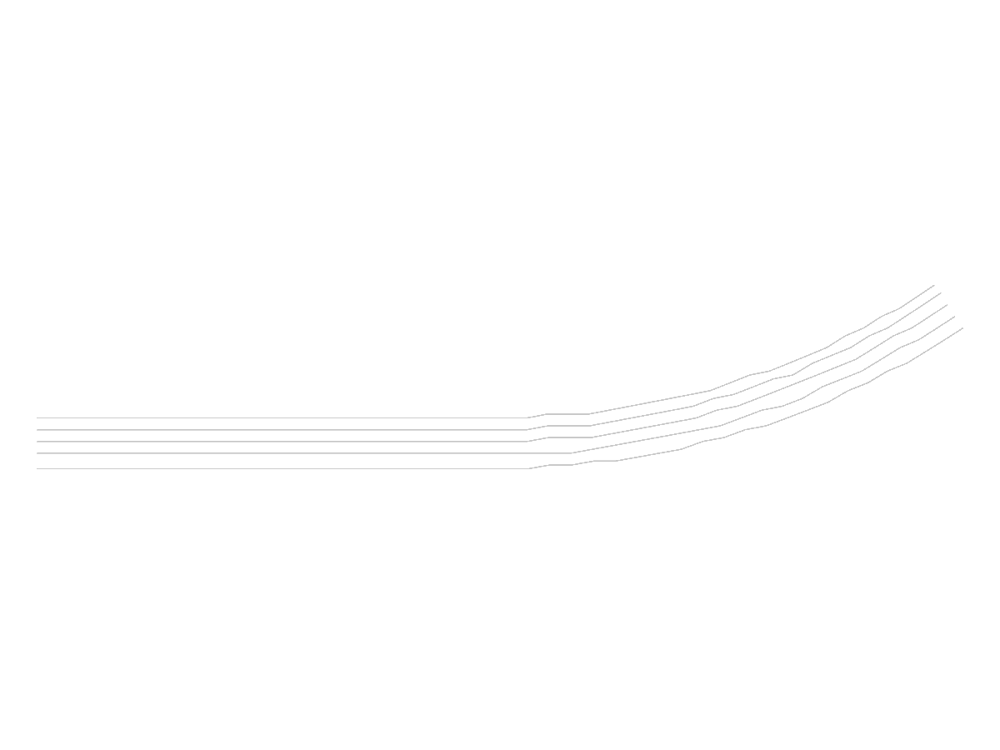

# REL-01 inspection and reproducibility — 2026-11-23

This report records two checks made for the REL-01 work item in
[current work](../roadmap/current.md). First, whether the authored
visualization can be inspected in `usdview`, as the
[Phase 1 exit](../roadmap/release-plan.md#phase-1-exit) requires. Second,
whether a clean rebuild reproduces the package digest, which is item 4 of the
[release gate](../releases/README.md#release-gate). Nothing here is a release
record.

## Summary

| Check | Result |
| --- | --- |
| `usdview` launch (L6) | `usdview` opens `basic.xodr` and exits cleanly, built and tested against the `lookdev` runtime. The `usd` runtime cannot run L6 (§2). |
| Storm drawing | Storm, the renderer `usdview` uses, draws the centerlines and lane borders of `basic.xodr`, `decoder/network.xodr`, `writer/projected.xodr`, and CARLA `Town01` and `Town02`, and they match the source geometry (§3). |
| Far from the origin | Storm draws `writer/projected.xodr`, about 5,400 km from the origin, in steps of about 0.5 m. Recentred near the origin, the same authored points draw smooth. The error comes from rendering, not from the authored data (§4). |
| Package digest | Before the fix, two clean Windows builds differed in 4 bytes of the plugin DLL: two copies of the link timestamp. After `/Brepro` was added to the bundle's targets, two clean builds give the same package digest (§5). |

## 1. Environment

- Local Windows 11, `ost` 0.23.21, at commit `c1d1dbf` (the fix in §5 is on
  top of it).
- The runtimes `openstrata-cy2026-windows-x86_64-py313-usd` (OpenUSD 26.08)
  and `openstrata-cy2026-windows-x86_64-py313-lookdev` (OpenUSD 26.08 with
  imaging and `usdview`; digest `sha256:330d3e83f9d7…`).
- Renders were made with `usdrecord` from the `lookdev` runtime, using the
  `HdStormRendererPlugin`, at 1,200 × 900 pixels. The wrapper script was a
  throwaway and is not committed; §3 describes the method.

## 2. `usdview` launch (L6)

`ost plugin test plugins/roadnetwork-opendrive --up-to 6` fails at once on
the declared `usd` profile, with `PROFILE_CAPABILITY_UNSATISFIED`: the profile
does not provide the `usdview` capability. Building and testing against
`lookdev` works:

```sh
ost plugin build plugins/roadnetwork-opendrive --profile lookdev
ost plugin test plugins/roadnetwork-opendrive --profile lookdev --up-to 6
```

The result was 13 passed, 0 failed, and 4 skipped. The L6 check
`usdview.launch` reported that `usdview` opened `basic.xodr` and exited
cleanly. L6 checks that `usdview` opens the asset, not what it draws, so §3
checks the drawing.

## 3. Storm drawing

`usdrecord`'s default camera views the `Z`-up network edge-on, so every
fixture draws as a single horizontal line. For each fixture, a wrapper stage
referenced the asset under `/Asset`, with `upAxis = "Z"`, and added an
orthographic camera looking straight down. The camera was centered on the
world bounds of `/Asset/Visualization` and framed them with a 4:3 aspect and
an 8% margin. Its apertures were set in tenths of a scene unit, as USD
defines for orthographic cameras.

| Fixture | Extent of `/Asset/Visualization` | What is drawn |
| --- | --- | --- |
| `basic.xodr` | 10.0 × 3.5 m | The two borders and the centerline of the single lane. |
| `decoder/network.xodr` | 106.6 × 27.6 m | Road `Main` with the shoulder lane of its second section widening from zero, the connecting road in junction `100`, and road `Bend`, whose arc and 0.25 m lane offset carry on from the straight ([image](assets/rel-01-2026-11-23/network.png)). |
| `writer/projected.xodr` | 118.4 × 23.4 m, at about (500,737, 5,427,710) m | A straight followed by an arc, drawn in steps (§4). |
| CARLA `Town01` | 411.0 × 345.3 m | The CARLA road grid, with every lane border and centerline, and the connecting roads inside the junctions ([image](assets/rel-01-2026-11-23/town01.png)). |
| CARLA `Town02` | 213.8 × 213.8 m | Likewise ([image](assets/rel-01-2026-11-23/town02.png)). |





The curves are drawn as linear `BasisCurves` with no authored width or
color, so Storm draws them as thin grey lines.

## 4. Far from the origin

The writer authors `writer/projected.xodr` as `float` points relative to a
`double` `xformOp:translate` on `/Asset/Visualization`
([ADR 0003 §5](../adr/0003-crs-axes-units.md#5-precision)). Through a
reference, every composed point is within 0.5 mm of its closed-form curve
(`roadnetworkOpendrive_file_format_contract`).

Storm still draws the curves in visible steps of about 0.5 m, which is the
`float` spacing at 5.4 × 10⁶ m:



The wrapper stage then translated `/Asset` by about −(500,796, 5,427,722) m, and
the camera was moved to match. Nothing else changed. The same authored points
now draw smooth:


The steps therefore come from rendering, consistent with Storm combining the
`double` translate and the points in single precision. They are not in the
authored data. To inspect a georeferenced network, reference it under a prim
whose translate brings it near the origin. The writer does not do this
itself, because ADR 0003 keeps source coordinates as authored.

## 5. Package digest

The bundle was built and packaged with the `usd` profile. Its build tree
(`.strata/targets/cy2026-windows-x86_64-py313-usd`) was then moved away, and
the bundle was built and packaged again. The workspace libraries' build trees
were kept, and their targets already used `/Brepro`.

Before the fix, the two archives had different digests
(`sha256:a64760d1…` and `sha256:5a53e49d…`). Extracted, they differed only in
`lib/libRoadnetworkOpendriveFileFormat.dll`, and only in 4 bytes. Two bytes
were at file offset `0x108`, the `TimeDateStamp` of the PE file header. The
other two were at `0x4F384`, the copy of that stamp in the debug directory.
The archive itself was already normalized: every entry has mtime 0 and
owner 0. The SBOM has a fixed creation time (`1970-01-01T00:00:00Z`) and
changed only because it records the DLL's checksum.

The fix compiles `roadnetworkOpendriveIo` and the plugin with `/Brepro`,
archives `roadnetworkOpendriveIo` with it, and links the plugin with it.
`roadnetwork-core` and `roadnetwork-usd` already did the same. After the fix,
two clean builds in a row both gave `sha256:f4969fd3b0cf…`.

Only Windows was measured. Ubuntu and macOS digests were not compared.

## 6. Gates after the fix

On the fix branch, with the `usd` profile:

| Gate | Result |
| --- | --- |
| `ost plugin test --up-to 5` | 12 pass, 0 fail, 4 skip |
| `ost plugin test --from-package --up-to 5` | 15 pass, 0 fail, 1 skip |
| `ost test` (composed root CTest) | 9 of 9 |
| `python tools/check_docs.py` | OK |
